# 垃圾分类网站

> 🎓 **计算机毕业设计 · 垃圾分类网站**
>
> 本仓库只放**项目介绍 + 运行截图**（截图是站点带水印的原图，存在仓库 `images/` 里）。
>
> 👉 **完整可运行源码 / 数据库脚本 / 部署文档：[点我获取](https://geekcode.top/archives/%E5%9E%83%E5%9C%BE%E5%88%86%E7%B1%BB%E7%BD%91%E7%AB%99?utm_source=github)**
>
> 💬 咨询微信：**ir9372**　|　🌐 更多项目：[极客代码 geekcode.top](https://geekcode.top/?utm_source=github)
>
> 📌 项目详情页：<https://geekcode.top/archives/%E5%9E%83%E5%9C%BE%E5%88%86%E7%B1%BB%E7%BD%91%E7%AB%99?utm_source=github>

<table><td width="230" align="center"> <b>扫码加微信 ir9372</b></td><td valign="middle">📦 源码 = 项目介绍 + 全部运行截图 + 数据库 + 部署文档 👉 点上方任意截图，直接跳到 <b>极客代码 geekcode.top</b> 详情页</td></table>

---

<h1>垃圾分类网站</h1>
<h2>项目概述</h2>

本项目为“垃圾分类网站”，旨在通过数字化手段普及垃圾分类知识，提升公众环保意识。系统采用前后端一体化架构，面向普通用户和管理员两类群体。核心功能包括前台的垃圾分类查询、垃圾图谱浏览及个人中心管理，以及后台对垃圾分类信息、管理员、用户、垃圾类型及系统配置的全面维护。技术栈基于 Spring Boot、MyBatis-Plus 和 Shiro，确保了系统的稳定性与安全性。适用场景为社区环保宣传、学校科普教育及公共信息服务站点，帮助用户快速识别垃圾类别，实现高效分类投放。

<h2>技术架构</h2>

系统采用经典的分层架构设计，后端基于 Java 语言，使用 Spring Boot 框架提供 RESTful API 服务，集成 MyBatis-Plus 作为持久层框架以简化数据库操作，引入 Apache Shiro 进行身份认证与权限控制。前端采用 Vue.js 构建单页应用（SPA），通过 Axios 与后端交互。

<strong>核心技术选型理由：</strong>

<ol>
<li><strong>Spring Boot</strong>: 简化配置，快速搭建微服务或单体应用基础，生态丰富。</li>
<li><strong>MyBatis-Plus</strong>: 在 MyBatis 基础上增强 CRUD 操作，减少样板代码，提高开发效率。</li>
<li><strong>Shiro</strong>: 轻量级安全框架，灵活处理登录、授权及会话管理，适合中小型项目。</li>
<li><strong>Vue.js</strong>: 响应式数据绑定，组件化开发，提升用户体验与维护性。</li>
</ol>

<strong>数据库设计要点：</strong>
数据库选用 MySQL，主要实体包括：<code>lajifenlei</code>（垃圾分类）、<code>lajitupu</code>（垃圾图谱）、<code>yonghu</code>（用户）、<code>lajifenleiguanliyuan</code>（垃圾分类管理员）、<code>lajileixing</code>（垃圾类型）及 <code>config</code>（配置）。表结构设计遵循第三范式，确保数据冗余最小化，并通过外键关联维持数据一致性。

<h2>功能模块</h2>
<h3>前台用户端</h3>
<ol>
<li><strong>首页展示</strong>：呈现系统概览及最新垃圾分类资讯入口。</li>
<li><strong>垃圾分类查询</strong>：列表展示各类垃圾的分类标准、投放要求及详情说明。</li>
<li><strong>垃圾图谱浏览</strong>：可视化展示垃圾种类及其归属类别，辅助用户直观理解。</li>
<li><strong>个人中心</strong>：用户注册、登录及个人信息管理功能。</li>
<li><strong>信息查询</strong>：支持查看垃圾分类管理员信息及垃圾类型列表。</li>
</ol>
<h3>后台管理端</h3>
<ol>
<li><strong>系统登录</strong>：管理员身份验证入口。</li>
<li><strong>垃圾分类管理</strong>：增删改查垃圾分类详细信息，支持批量操作。</li>
<li><strong>垃圾图谱管理</strong>：维护垃圾图谱数据，更新分类关系。</li>
<li><strong>用户管理</strong>：查看注册用户信息，执行禁用或删除操作。</li>
<li><strong>管理员管理</strong>：维护垃圾分类管理员账号及权限配置。</li>
<li><strong>垃圾类型管理</strong>：定义并管理系统中的垃圾大类（如可回收物、有害垃圾等）。</li>
<li><strong>配置文件管理</strong>：修改系统基础参数，如网站名称、版权信息等。</li>
</ol>
<h2>用户角色与权限</h2>

系统主要包含两种角色：普通用户（前台）和系统管理员（后台）。

<table>
<thead>
<tr>
<th align="left">角色</th>
<th align="left">访问范围</th>
<th align="left">具体权限描述</th>
</tr>
</thead>
<tbody><tr>
<td align="left"><strong>普通用户</strong></td>
<td align="left">前台页面</td>
<td align="left">1. <strong>浏览权限</strong>：可查看首页、垃圾分类列表、垃圾图谱、垃圾类型列表及管理员信息。2. <strong>个人管理</strong>：可进行注册、登录、退出及修改个人资料。3. <strong>无编辑权</strong>：仅具备只读权限，无法修改后台数据。</td>
</tr>
<tr>
<td align="left"><strong>系统管理员</strong></td>
<td align="left">后台页面</td>
<td align="left">1. <strong>全量数据管理</strong>：拥有对所有业务实体（垃圾分类、垃圾图谱、用户、管理员、垃圾类型、配置）的创建、读取、更新、删除（CRUD）权限。2. <strong>路由访问</strong>：可访问 <code>/lajifenlei</code>, <code>/lajitupu</code>, <code>/yonghu</code>, <code>/lajifenleiguanliyuan</code>, <code>/lajileixing</code>, <code>/config</code> 所有后台路由。3. <strong>系统配置</strong>：可修改全局配置文件。</td>
</tr>
</tbody></table>

<em>注：根据现有源码上下文，未提及细分的“超级管理员”或“普通管理员”角色差异，默认后台登录者拥有上述完整管理权限。</em>

<h2>项目特色与创新点</h2>
<ol>
<li><strong>知识图谱化展示</strong>：引入“垃圾图谱”模块，将抽象的分类规则转化为结构化数据展示，降低用户认知门槛，比传统文本列表更直观。</li>
<li><strong>前后端分离与安全管控</strong>：采用 Vue + Spring Boot 分离架构，结合 Shiro 框架实现细粒度的权限控制，确保前台数据只读、后台数据可写的安全隔离。</li>
<li><strong>模块化内容管理</strong>：将“垃圾类型”、“垃圾分类”、“管理员”独立建模，便于后续扩展新的分类标准或接入更多科普内容，具备良好的可维护性。</li>
<li><strong>轻量化部署</strong>：基于 Spring Boot 内嵌容器特性，无需复杂中间件配置，适合高校毕设演示及小型社区快速落地。</li>
</ol>
<h2>部署环境</h2>

为确保系统正常运行，需准备以下软件环境：

<ol>
<li><strong>Java 运行环境</strong>：JDK 1.8 或更高版本（推荐 JDK 8/11）。</li>
<li><strong>数据库</strong>：MySQL 5.7 或 8.0+，需导入项目提供的 SQL 脚本初始化表结构。</li>
<li><strong>构建工具</strong>：Maven 3.6+，用于依赖管理和项目打包。</li>
<li><strong>前端环境</strong>：Node.js 14+ 及 npm/yarn，用于编译 Vue 前端资源。</li>
<li><strong>Web 服务器</strong>：内置 Tomcat（Spring Boot 自带）或外部 Nginx（用于生产环境静态资源托管及反向代理）。</li>
<li><strong>浏览器</strong>：Chrome、Edge、Firefox 等现代主流浏览器。</li>
</ol>
<h2>五、技术特性</h2>
<ul>
<li>前后端集成部署，前端资源打包至后端 static 目录</li>
<li>使用 MyBatis-Plus 简化数据访问层开发</li>
<li>集成 Shiro 权限框架实现角色权限控制</li>
</ul>
<h2>六、功能模块截图</h2>
<h3>前台用户端</h3>
<h4>前台登录页</h4>

<h4>前台注册页</h4>

<a href="https://geekcode.top/archives/%E5%9E%83%E5%9C%BE%E5%88%86%E7%B1%BB%E7%BD%91%E7%AB%99?utm_source=github" title="查看完整源码">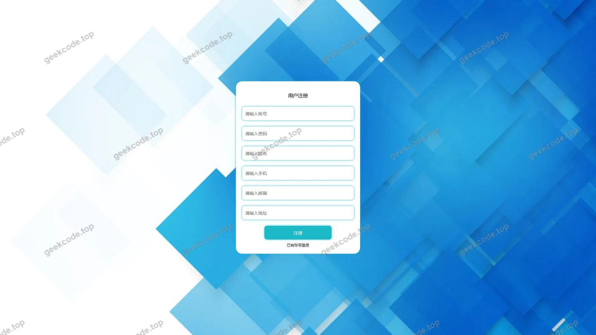</a>

<h4>前台-垃圾分类列表</h4>

<a href="https://geekcode.top/archives/%E5%9E%83%E5%9C%BE%E5%88%86%E7%B1%BB%E7%BD%91%E7%AB%99?utm_source=github" title="查看完整源码">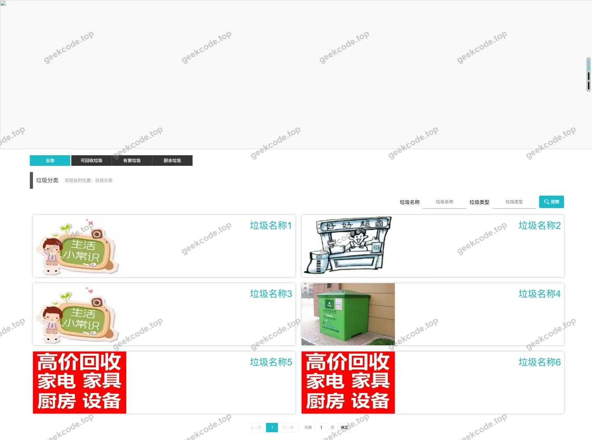</a>

<h4>前台首页</h4>

<a href="https://geekcode.top/archives/%E5%9E%83%E5%9C%BE%E5%88%86%E7%B1%BB%E7%BD%91%E7%AB%99?utm_source=github" title="查看完整源码">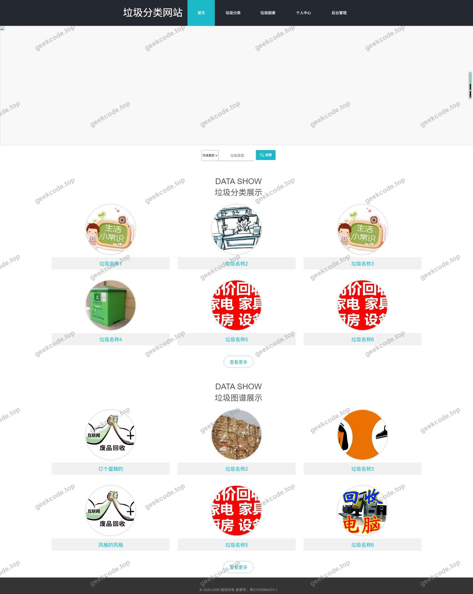</a>

<h4>前台个人中心</h4>

<a href="https://geekcode.top/archives/%E5%9E%83%E5%9C%BE%E5%88%86%E7%B1%BB%E7%BD%91%E7%AB%99?utm_source=github" title="查看完整源码">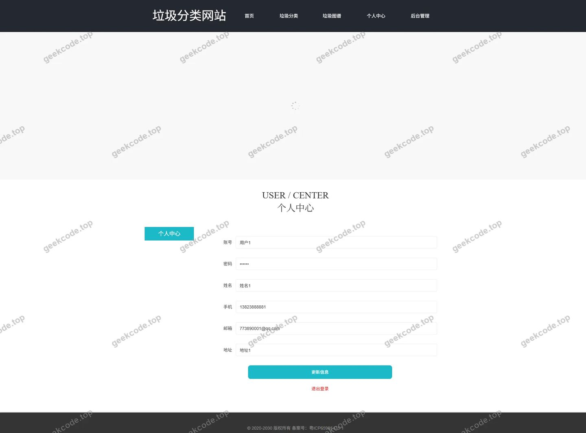</a>

<h4>前台-垃圾图谱列表</h4>

<a href="https://geekcode.top/archives/%E5%9E%83%E5%9C%BE%E5%88%86%E7%B1%BB%E7%BD%91%E7%AB%99?utm_source=github" title="查看完整源码">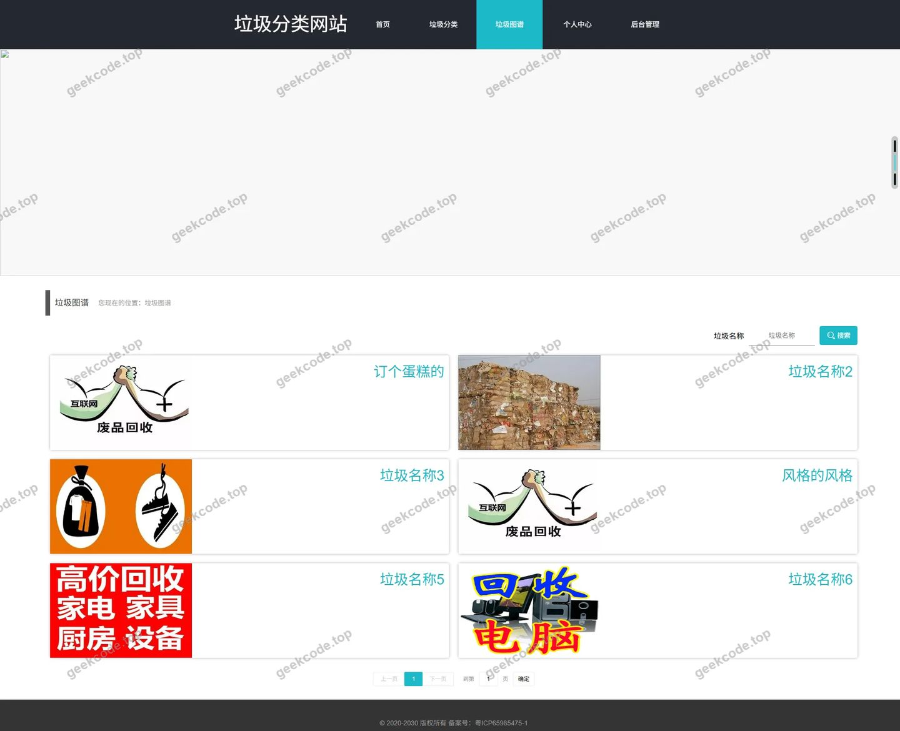</a>

<h4>前台-垃圾分类-详情</h4>

<a href="https://geekcode.top/archives/%E5%9E%83%E5%9C%BE%E5%88%86%E7%B1%BB%E7%BD%91%E7%AB%99?utm_source=github" title="查看完整源码">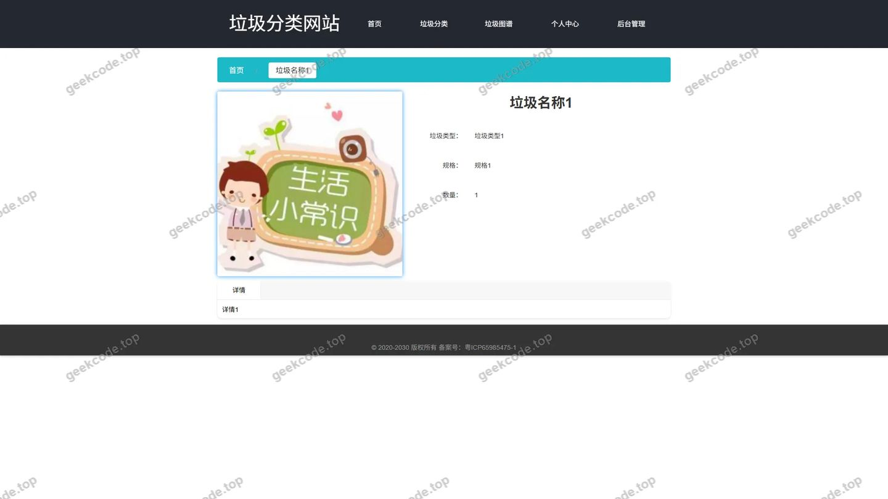</a>

<h4>前台-垃圾分类管理员列表</h4>

<a href="https://geekcode.top/archives/%E5%9E%83%E5%9C%BE%E5%88%86%E7%B1%BB%E7%BD%91%E7%AB%99?utm_source=github" title="查看完整源码">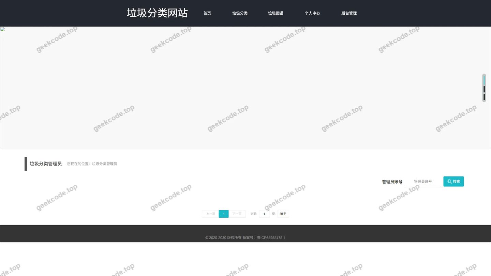</a>

<h4>前台-垃圾类型列表</h4>

<h4>前台-垃圾分类管理员-详情</h4>

<a href="https://geekcode.top/archives/%E5%9E%83%E5%9C%BE%E5%88%86%E7%B1%BB%E7%BD%91%E7%AB%99?utm_source=github" title="查看完整源码">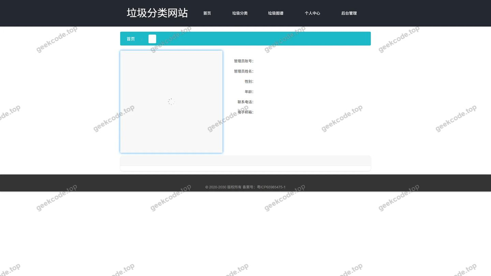</a>

<h3>后台管理端</h3>
<h4>后台-系统配置</h4>

<a href="https://geekcode.top/archives/%E5%9E%83%E5%9C%BE%E5%88%86%E7%B1%BB%E7%BD%91%E7%AB%99?utm_source=github" title="查看完整源码">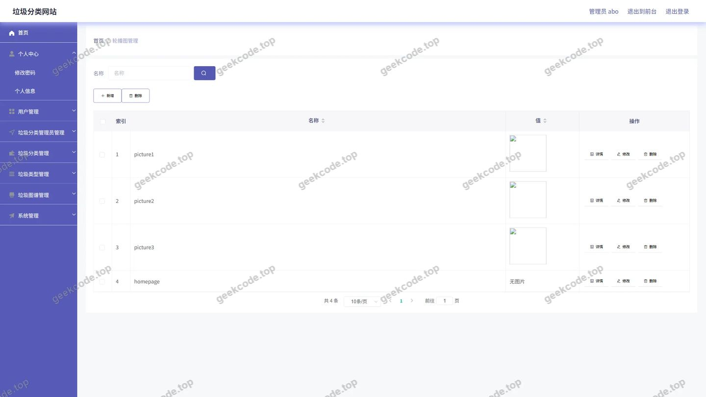</a>

<h4>后台首页</h4>

<a href="https://geekcode.top/archives/%E5%9E%83%E5%9C%BE%E5%88%86%E7%B1%BB%E7%BD%91%E7%AB%99?utm_source=github" title="查看完整源码">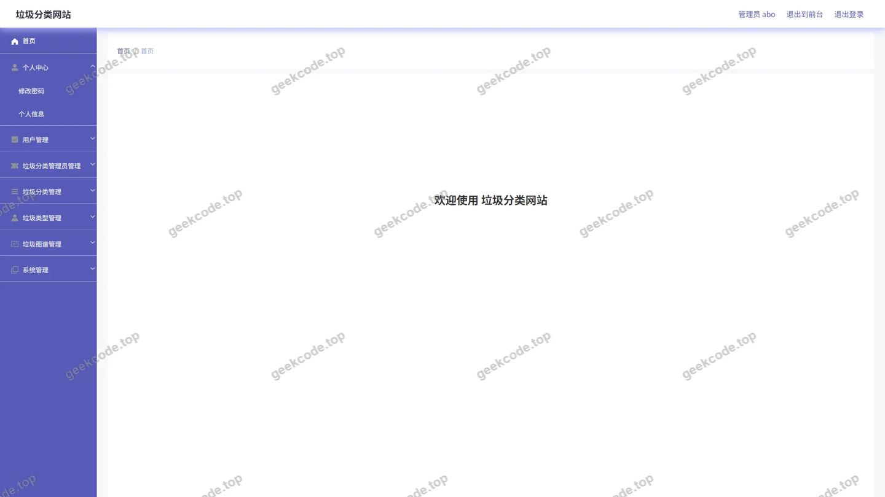</a>

<h4>后台-垃圾分类</h4>

<a href="https://geekcode.top/archives/%E5%9E%83%E5%9C%BE%E5%88%86%E7%B1%BB%E7%BD%91%E7%AB%99?utm_source=github" title="查看完整源码">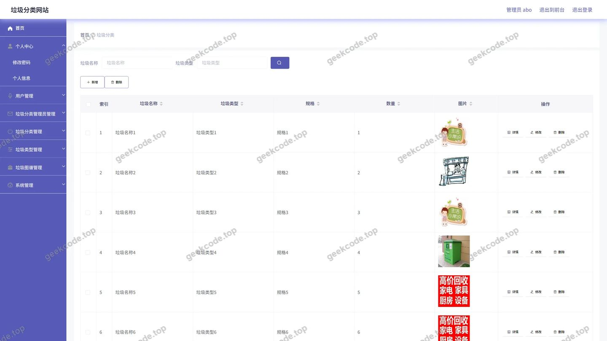</a>

<h4>后台-垃圾分类管理员</h4>

<a href="https://geekcode.top/archives/%E5%9E%83%E5%9C%BE%E5%88%86%E7%B1%BB%E7%BD%91%E7%AB%99?utm_source=github" title="查看完整源码">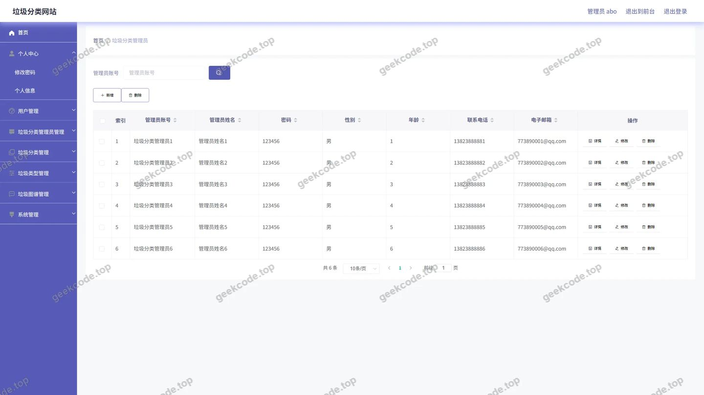</a>

<h4>后台-垃圾类型</h4>

<a href="https://geekcode.top/archives/%E5%9E%83%E5%9C%BE%E5%88%86%E7%B1%BB%E7%BD%91%E7%AB%99?utm_source=github" title="查看完整源码">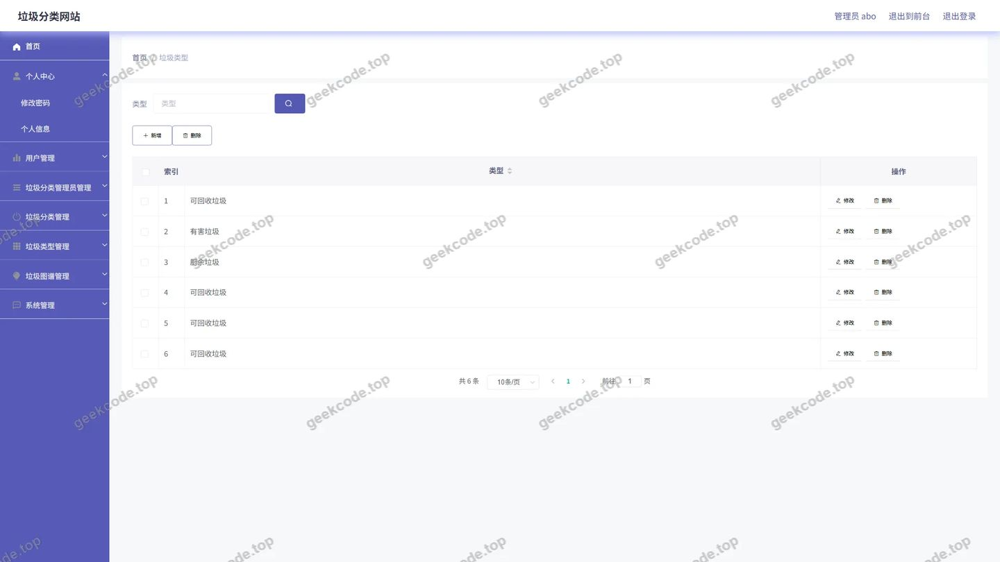</a>

<h4>后台-垃圾图谱</h4>

<a href="https://geekcode.top/archives/%E5%9E%83%E5%9C%BE%E5%88%86%E7%B1%BB%E7%BD%91%E7%AB%99?utm_source=github" title="查看完整源码">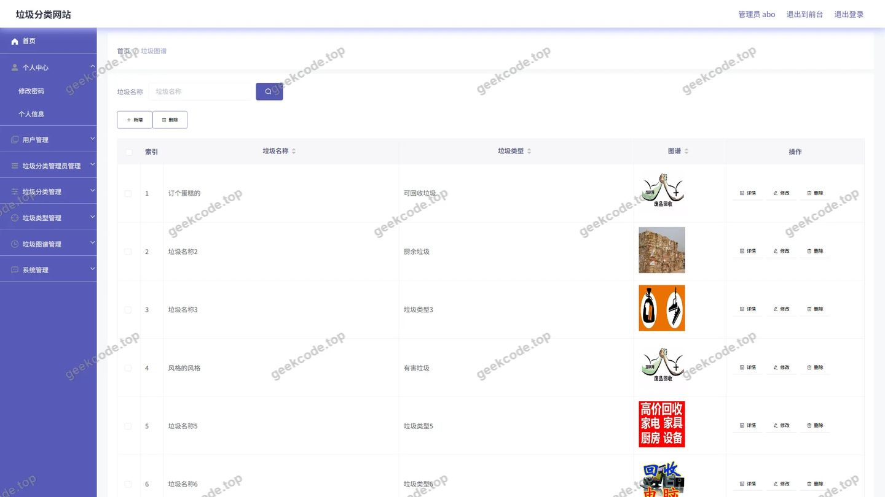</a>

<h4>后台-登录</h4>

<a href="https://geekcode.top/archives/%E5%9E%83%E5%9C%BE%E5%88%86%E7%B1%BB%E7%BD%91%E7%AB%99?utm_source=github" title="查看完整源码">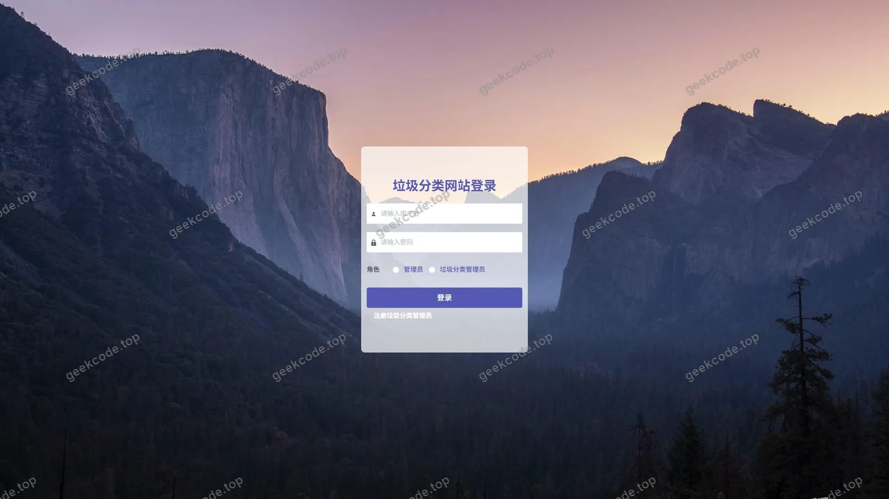</a>

---

## 获取完整源码

| 项目 | 说明 |
| --- | --- |
| 项目名 | 垃圾分类网站 |
| 运行截图 | 本文 17 张（站点带水印原图，仓库 `images/` 目录） |
| 完整源码 | [https://geekcode.top/archives/%E5%9E%83%E5%9C%BE%E5%88%86%E7%B1%BB%E7%BD%91%E7%AB%99?utm_source=github](https://geekcode.top/archives/%E5%9E%83%E5%9C%BE%E5%88%86%E7%B1%BB%E7%BD%91%E7%AB%99?utm_source=github) |
| 咨询微信 | **ir9372**（备注：jingpin-yuanma） |
| 更多项目 | [极客代码 geekcode.top](https://geekcode.top/?utm_source=github) |

> 需要源码、部署、改配置、跑不起来等问题，加微信 ir9372 沟通，说明项目名即可。
